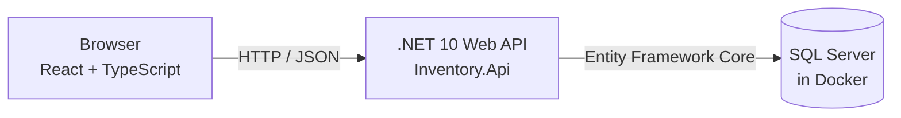

# Architecture

> **Planned design, partly built.** Products, warehouses, receipt batches, and receiving stock (with its movement record) are implemented. The rest is still planned and will be updated as it is built.

## Overview

The application will have three runtime pieces, all running on one developer machine:

1. A **React + TypeScript** single-page app in the browser.
2. A **.NET 10 Web API** that holds the business rules.
3. A **SQL Server** database running in a Docker container.

## How the pieces connect

- **Browser to API.** The React app will send HTTP requests (for example, "receive 40 units of product X into warehouse Y") and receive JSON responses. The browser will never talk to the database directly.
- **API to database via Entity Framework Core.** Entity Framework (EF) Core is a library that maps C# classes to database tables. The API will work with C# objects, and EF Core will translate that into SQL queries and send them to SQL Server. Database structure changes will be managed with EF Core migrations.
- **SQL Server in Docker.** The database will run as a container defined in `compose.yaml` (planned), so no manual SQL Server installation will be needed. SQL Server's data will be kept in a named Docker volume so it survives container restarts.
- **Tests.** An xUnit project (`tests/Inventory.Api.Tests`) will cover the API's business rules.

## Planned components

| Path | Role |
| --- | --- |
| `backend/Inventory.Api/` | .NET Web API: endpoints, business rules, EF Core data model |
| `frontend/inventory-web/` | React + TypeScript user interface |
| `tests/Inventory.Api.Tests/` | xUnit tests |
| `compose.yaml` | Local SQL Server container and its named data volume |
| `InventoryManagement.slnx` | .NET solution tying the backend and tests together |

## Core domain concepts (planned)

- **Product**: something that is stocked.
- **Warehouse**: a location where stock is held.
- **Receipt batch** (built): a quantity of a product received into a warehouse on a specific date. Stock is tracked per batch so its age is known. It stores the quantity received (never changes) and the quantity on hand (changed by issue and adjust operations, and later by transfers).
- **Stock movement** (built for receive, issue, and adjust): an append-only record of a change to stock, with a signed quantity change and, for adjustments, a reason. Transfers are not built yet.

## Key rules

- **Transfers will preserve the original receipt date.** Moving stock between warehouses will not make it look newer, so aging reports stay accurate.
- **No FIFO.** The app does not automatically choose which batch to issue from. Users select the batch to issue from.

## Movement recording and history

Each inventory operation (receive, issue, transfer, adjust) will record its stock movement as that operation is implemented. The feature for viewing movement history comes later, with the inventory views and alerts.

## Out of scope

- Deployment or hosting; the app will run locally only.
- Integrations with external systems.
