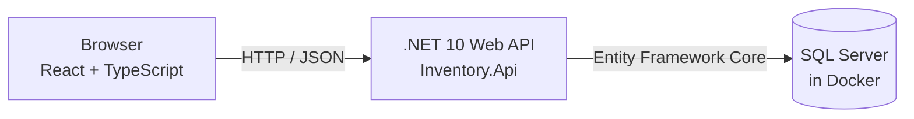

# Architecture

> **Built.** Products, warehouses, receipt batches, receiving, issuing, adjusting, and transferring stock (each with its movement records), plus read-only movement history, stock levels, and low-stock and aging alerts, are implemented in the API, and the React frontend uses all of them. The app runs locally only.

## Overview

The application has three runtime pieces, all running on one developer machine:

1. A **React + TypeScript** single-page app in the browser.
2. A **.NET 10 Web API** that holds the business rules.
3. A **SQL Server** database running in a Docker container.

## How the pieces connect

- **Browser to API.** The React app sends HTTP requests (for example, "receive 40 units of product X into warehouse Y") and receives JSON responses. The browser never talks to the database directly. In development the Vite server (<http://localhost:5173>) serves the app and forwards `/api` and `/health` requests to the API at <http://localhost:5127>, so the browser sees a single origin and the API needs no CORS settings. API errors come back as `{ "error": "..." }` or a validation problem, and the frontend shows the message.
- **API to database via Entity Framework Core.** Entity Framework (EF) Core is a library that maps C# classes to database tables. The API works with C# objects, and EF Core translates that into SQL queries and sends them to SQL Server. Database structure changes are managed with EF Core migrations.
- **SQL Server in Docker.** The database runs as a container defined in `compose.yaml`, so no manual SQL Server installation is needed. SQL Server's data is kept in a named Docker volume so it survives container restarts.
- **Tests.** An xUnit project (`tests/Inventory.Api.Tests`) covers the API's business rules, using an in-memory database instead of SQL Server.

## Components

| Path | Role |
| --- | --- |
| `backend/Inventory.Api/` | .NET Web API: endpoints, business rules, EF Core data model |
| `frontend/inventory-web/` | React + TypeScript user interface (Vite, React Router) |
| `tests/Inventory.Api.Tests/` | xUnit tests |
| `compose.yaml` | Local SQL Server container and its named data volume |
| `InventoryManagement.slnx` | .NET solution tying the backend and tests together |

## Core domain concepts

- **Product**: something that is stocked. It has a reorder threshold (default 0), the quantity at or below which it counts as low on stock.
- **Warehouse**: a location where stock is held.
- **Receipt batch**: a quantity of a product received into a warehouse on a specific date. Stock is tracked per batch so its age is known. It stores the quantity received (never changes) and the quantity on hand (changed by issue and adjust operations, and later by transfers).
- **Stock movement**: an append-only record of a change to stock, with a signed quantity change and, for adjustments, a reason. Transfers record two movements, `TransferOut` and `TransferIn`, which share a `TransferId`.

## Key rules

- **Transfers preserve the original receipt date.** Moving stock between warehouses does not make it look newer, so aging reports stay accurate.
- **No FIFO.** The app does not automatically choose which batch to issue from. Users select the batch to issue from.

## Movement recording and history

Each inventory operation (receive, issue, transfer, adjust) records its stock movement. Movement history is viewable through `GET /api/stock-movements`, with filters and paging. Stock levels and the low-stock and aging-stock alerts are computed from batches when requested. The only stored input is each product's `ReorderThreshold`, which the low-stock alert compares against.

## Frontend

`frontend/inventory-web/src` holds the React app. `api.ts` is the only place that calls the API; `types.ts` mirrors the API's JSON; `hooks.ts` has `useLoad`, which loads data and ignores out-of-date responses. One page per feature lives in `pages/`:

| Route | Page | API it uses |
| --- | --- | --- |
| `/` | Alerts: low stock (optionally for one warehouse) and aging stock (adjustable days) | `/api/inventory/alerts/*` |
| `/products`, `/warehouses` | List, create, edit, deactivate (no delete; code and SKU are fixed) | `/api/products`, `/api/warehouses` |
| `/receive` | Receive stock into a new dated batch (active products and warehouses only) | `POST /api/receipt-batches` |
| `/batches` | Batches with Issue, Adjust, and Transfer actions on a batch the user picks | `/api/receipt-batches`, `/api/stock/*` |
| `/stock-levels` | Quantity on hand per product and warehouse | `/api/inventory/stock-levels` |
| `/movements` | Movement history with filters and paging | `/api/stock-movements` |

The frontend holds no business rules of its own beyond basic form checks; the API stays the source of truth and its error messages are shown as-is.

## Out of scope

- Deployment or hosting; the app will run locally only.
- Integrations with external systems.
